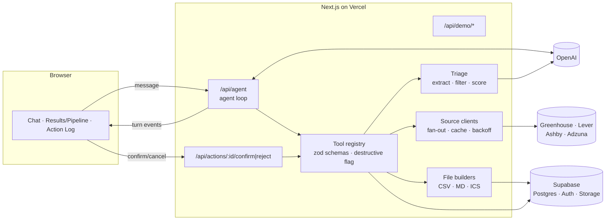
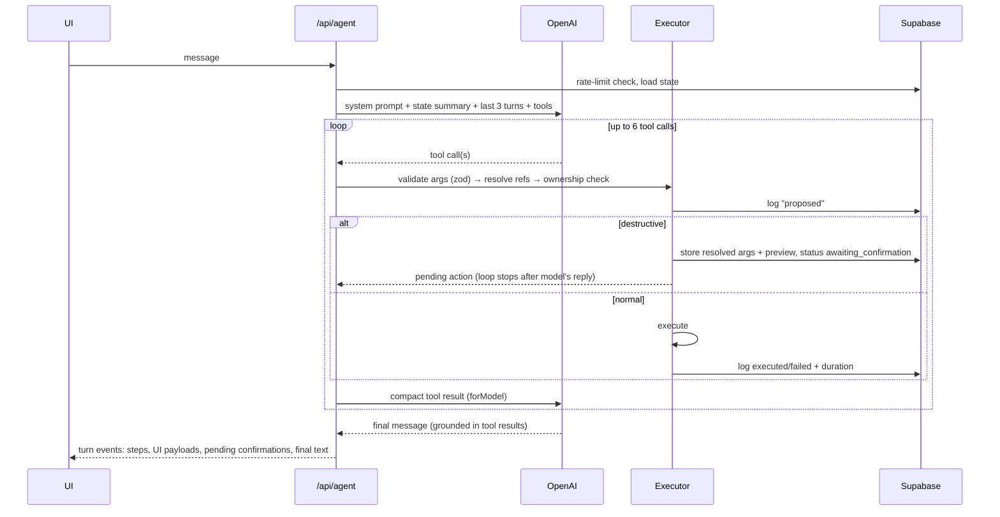

# Offer Desk: Build Plan

> CS4680 Assignment 4, AI Agent Project. Status: **confirmed**; Phases 0–2 done (Phase 2 pending its gate review), Phase 3 next. Decisions: see [Decisions](#decisions) and [DECISIONS.md](DECISIONS.md).

## 1. What we're building

**Offer Desk** is a job-search triage agent for new-grad software engineers. You type requests like *"find entry-level backend roles in SoCal or remote posted this week."* The agent searches real job boards, reads each posting to pull out the actual requirements (years of experience, clearance, location), drops the fake "entry-level" ones, ranks the rest against your profile, and tracks what you apply to. It also generates real files: a CSV export, an apply checklist, and calendar invites for interviews.

**The problem (worth 10%):** many "entry level" postings ask for 3+ years, a clearance, or an onsite location that doesn't work for you. Searching boards, removing duplicates, and reading every description to find that out is the real time sink for new grads. Offer Desk handles that triage at volume and shows its evidence, quoting the description, so you can trust each filter.

**The core design rule:** *the LLM routes and extracts; code computes.* The LLM does three jobs: (1) picks tools and fills their arguments, (2) pulls structured fields out of messy descriptions, and (3) writes short summaries of tool results. Filtering, scoring, deduping, counting, and date math are all deterministic code. The LLM never makes up job data or numbers.

### How the assignment requirements map to the design

| Requirement | Where it lives |
|---|---|
| LLM integration: send/receive, API errors, rate limits | `lib/llm/`: OpenAI client wrapper, retries with growing waits + jitter, honors `Retry-After`, global daily request cap |
| Turn LLM output into commands | OpenAI function calling, then the tool registry. Each tool has a zod schema, and arguments are validated before anything runs |
| Actions across **different domains** | **External APIs** (Greenhouse, Lever, Ashby, Adzuna) · **Database** (pipeline CRUD in Supabase) · **Files** (CSV, Markdown checklist, `.ics` in Supabase Storage) |
| UI: natural-language input, results, status, feedback | Three panels: chat, results/pipeline board, action log. Plus source status chips, the triage breakdown, and file cards |
| Validate LLM output | zod validation of tool arguments, refs must exist and belong to the session, Structured Outputs + zod for extraction, unknown tools rejected |
| Graceful errors | Tool errors go back to the model as typed errors so it can recover or ask. Partial source failures still return results. Friendly messages in the UI |
| Confirm destructive ops | Destructive tools only *propose* an action. A modal shows a preview list, and a separate endpoint runs the already-validated stored action |
| Log every action | `action_log` table, one row per tool call with its status changes, shown live in the right panel |

### Rubric → where the points come from

| Rubric item | Weight | How we earn it |
|---|---|---|
| Problem & relevance | 10% | Clear new-grad pain point, problem section in the README, "140 → 57" breakdown that shows the time saved |
| Design & implementation | 30% | Clean split between LLM and code, tool registry, confirmation by stored action ID, caching and backoff, tests |
| Prompt engineering | 20% | Versioned prompts, few-shot extraction, Structured Outputs, validation-error retry, grounding rules, **a small extraction eval with before/after scores** in PROMPTS.md |
| UI/UX | 10% | Three-panel layout, live status, preview modal, one-click demo profile |
| Demo | 30% | Scripted 90-second flow (section 9), bundled snapshot so the demo works even if an API is down |

## 2. Scope: what's in and what's cut

**In (the core):**
- Sources: **Greenhouse, Lever, Ashby** (free, no key, full descriptions, direct apply links) + **Adzuna as optional** (enabled only when the key env vars are set)
- Search → dedupe → cheap title/date/location prefilter → LLM extraction → code filter → code scoring → ranked results with "why matched"
- Pipeline: save, change stage, notes, list, funnel stats, **archive and delete (destructive)**
- Files: CSV export, apply checklist (Markdown), interview `.ics`, **delete file (destructive)**
- Confirmation modal with preview, action log panel, per-session rate limits, anonymous sessions with Row Level Security
- "Load demo profile" and "Seed sample pipeline" buttons
- Extraction eval set (about 15 hand-labeled postings) comparing prompt v1 to v2
- Docs: README (with a Mermaid diagram), PROMPTS.md, DECISIONS.md

**Cut, and why:**
| Cut | Reason | Replacement |
|---|---|---|
| The Muse | Returns a 403 Cloudflare challenge to non-browser clients (tested 2026-11-09) | n/a |
| PDF files | PDF and chart rendering in a serverless function is a time sink | Markdown checklist + CSV (both open anywhere) |
| Funnel report file | Same reason | Funnel chart in the UI |
| Drag-and-drop kanban | Polish that doesn't earn points | Fixed stage columns |
| Fuzzy dedupe | Hard to get right | Exact normalized key, noted as a known limitation |

**Stretch (only if ahead of schedule):** live streaming of turn events (the event format is designed for it from day one, see section 4.4), routing eval for the agent, Adzuna salary fields.

## 3. Tech stack

| Layer | Choice | Why |
|---|---|---|
| Framework | Next.js (App Router, TypeScript) | Decided. API routes act as the backend, so there's one deploy |
| UI | Tailwind + shadcn/ui, lucide icons, Recharts (funnel) | Fast and clean without designing from scratch |
| Hosting | Vercel | Decided. Deploys from GitHub on every push |
| DB / Auth / Files | Supabase: Postgres, anonymous auth, Storage | One service for all three. Row Level Security isolates graders |
| LLM | OpenAI SDK, **Responses API** (DECISIONS 009) | Function calling + Structured Outputs (`text.format`) |
| Models | `OPENAI_MODEL` (agent) and `OPENAI_EXTRACT_MODEL` (extraction), both env vars | Extraction is high-volume, so it can use a cheaper model |
| Validation | zod | Validates tool arguments and LLM output |
| Tests | Vitest | Unit tests for the deterministic core |

## 4. Architecture

### 4.1 System overview



### 4.2 Folder layout

```
app/
  page.tsx                      three-panel shell
  api/agent/route.ts            POST: one agent turn
  api/actions/[id]/confirm/route.ts
  api/actions/[id]/reject/route.ts
  api/demo/profile/route.ts     load demo profile
  api/demo/seed/route.ts        seed sample pipeline
components/                     chat, results, pipeline, action-log, confirm-modal, ...
lib/
  llm/        client.ts (OpenAI + retry), retry.ts
  agent/      loop.ts, context.ts (state summary), events.ts
  tools/      registry.ts, refs.ts (short-ref resolver), executor.ts, defs/*.ts (one file per tool)
  sources/    greenhouse.ts, lever.ts, ashby.ts, adzuna.ts, fanout.ts, normalize.ts, cache.ts
  triage/     prefilter.ts, extract.ts, filter.ts, score.ts, dedupe.ts
  files/      csv.ts, checklist.ts, ics.ts, storage.ts
  safety/     rate-limit.ts, caps.ts
  db/         supabase clients (server user-scoped + service role), typed queries
prompts/      system.v1.md, extract.v1.md, extract.v2.md, examples/*.json
data/         ats_boards.json, demo_profile.json, sample_postings.json (snapshot)
scripts/      probe-sources.ts, verify-boards.ts, eval-extraction.ts, snapshot-postings.ts
evals/        extraction/*.json (hand-labeled postings + expected fields)
supabase/migrations/*.sql
tests/
DECISIONS.md  PROMPTS.md  README.md  .env.example
```

### 4.3 Data model (Supabase)

**Shared public data** (written by the server with the service-role key; read-only for users). Job postings are public, so sharing them lets one grader's search warm the cache for everyone:

| Table | Key columns |
|---|---|
| `postings` | id, source, source_id, company, title, location, remote, url, description, posted_at, dedupe_key, raw jsonb (unique on source + source_id) |
| `extractions` | posting_id, description_hash (unique), extracted jsonb, status (`ok`/`failed`), confidence (`full`/`truncated`), model, prompt_version |
| `board_cache` | key (`ats:slug`), jobs jsonb (normalized light list), fetched_at, expires_at, status |
| `search_cache` | key (hash of source + normalized query + location + page), posting_ids[], status jsonb, expires_at (Adzuna only) |
| `counters` | key (e.g. `adzuna:2026-11-09`, `openai:2026-11-09`, `user:<id>:<hour>`, `ip:<hash>:<hour>`), count, expires_at. Replaces the planned `quota` and `rate_limits` tables (DECISIONS 016) |

**User-owned** (Row Level Security: `user_id = auth.uid()` on every table):

| Table | Key columns |
|---|---|
| `profiles` | user_id, name, skills[], grad_date, locations[], remote_ok, max_years, filters jsonb |
| `result_sets` | id, user_id, ref (`S1`), query jsonb, posting_ids[], breakdown jsonb, ranked jsonb |
| `refs` | user_id, ref (`J12`, `A3`, `F2`), kind, target_id (maps short refs to UUIDs) |
| `applications` | id, user_id, posting_id, stage (`saved/applied/screen/interview/offer/rejected/archived`), applied_at, next_step_at, notes, updated_at |
| `files` | id, user_id, kind (`csv/checklist/ics`), storage_path, supersedes_id, created_at |
| `messages` | id, user_id, turn_id, role, content (only the final text, used for the last-3-turns context) |
| `action_log` | id, user_id, turn_id, tool, args jsonb, resolved_args jsonb, preview jsonb, status, result_summary, error, duration_ms, created_at, expires_at |

`action_log.status` moves through: `proposed → invalid | executed | failed | awaiting_confirmation → (confirmed → executed | failed) | rejected | expired`.

### 4.4 Agent turn



**Key design choices in the loop:**
1. **Context = state, not full history.** Each turn sends the system prompt, a compact JSON state block (profile, pipeline counts by stage, the latest result set's top refs, pending confirmations), and **only the last 3 turns of final text**. This keeps token use flat and makes "the first 5" refer to something concrete.
2. **Short refs instead of UUIDs.** Tools return `J1…J57` (postings), `A1…` (applications), `S1` (result sets), `F1` (files). The resolver maps them to UUIDs scoped to the session. The model never handles a UUID, so it can't make one up or copy one wrong, and an unknown ref is rejected with a clear error.
3. **Each tool returns two things.** `forModel` is small (refs, key fields, counts) and `forUI` is the full payload for rendering. The model never sees 140 descriptions.
4. **Pass sets, not lists.** `triage_results` takes a result-set ref (`S1`), not 140 IDs. Bulk tools take a `where` selector (`{stage, untouched_days}`) that **code** turns into the actual records.
5. **Errors are typed results.** Validation failures and tool errors go back to the model as `{error: {code, message}}`, so it can fix the call or ask a question. Each tool call gets one fix attempt, then the loop reports the error.
6. **Turn events.** The route returns an ordered list of events (`step_started`, `step_done`, `source_status`, `ui_payload`, `pending_action`, `final`). The UI renders them as a timeline. Streaming later only changes the transport (newline-delimited JSON), not the format.

### 4.5 Confirmation flow

- A destructive tool (`archive_applications`, `delete_applications`, `delete_files`) **resolves and validates** its target list, caps it at 100 records, saves `resolved_args` + `preview` (count + titles/companies) as an `awaiting_confirmation` action with a 15-minute expiry, and returns `pending_action` to the model and UI.
- The model's rules say to describe the pending action and never claim it's done.
- `POST /api/actions/:id/confirm` checks: the action belongs to the user, is still `awaiting_confirmation`, and hasn't expired. Then it runs **the stored `resolved_args`**. The LLM can't change what the user saw. Cancel → `rejected`.
- After a confirm or cancel, a system note is added to `messages`, so the next turn knows the outcome.
- **Test:** calling a destructive tool's executor directly without a confirmation record throws.

### 4.6 Search and triage pipeline

```
search_jobs                                     triage_results(S1, filters?)
──────────────                                  ───────────────────────────────
fan out to sources (cache first)                take ranked candidates from S1
  ├─ Greenhouse: list WITHOUT content →         ├─ extract (cache by description hash;
  │  title match → fetch content for matches    │  parallel, concurrency ~8, max 25)
  ├─ Lever / Ashby: one call per board          ├─ code filter: years ≤ max (or null),
  └─ Adzuna (optional, quota-guarded)           │  no required clearance, location, age
normalize → Posting                             ├─ code score: weighted skill overlap
dedupe (company|title|location, ATS wins)       │  + new-grad bonus + location bonus
prefilter in code (title seniority words,       ├─ "why matched" line from fields + score
  posted_within_days, location)                 └─ breakdown: fetched → deduped →
→ result set S1 + counts + source status            prefiltered → extracted → dropped
                                                    (years / clearance / location) → final
```

- **Board selection:** `data/ats_boards.json` has about 150 companies `{name, ats, slug, tags[]}` (tags like `backend`, `socal`, `remote-friendly`). Each search picks at most 40 boards by tag/keyword match. Concurrency 8, 5-second timeout per call.
- **Greenhouse two-pass fetch:** a board with `content=true` can be several MB (Stripe: 5.9 MB, 12.5x the list). Fetch the list first, match titles in code, then fetch content only for the matches.
- **Cache per board (DECISIONS 005):** each board's normalized job list is cached about 6 hours and the query filter runs in code over the cache, because Lever and Ashby boards can be several MB with no light list mode. The per-query `search_cache` is kept only for Adzuna.
- **Lever descriptions (DECISIONS 007):** requirements live in `lists[]`, so the description is built from intro + lists + additional.
- **Adzuna:** used only when `ADZUNA_APP_ID`/`ADZUNA_APP_KEY` are set and the daily global budget (100 calls/day in `counters`) isn't used up. **Deferred:** no key yet (DECISIONS 017). If descriptions are truncated (to verify in Phase 0), extraction is marked `confidence: truncated`, and fields not found stay `unknown`. Never guessed.
- **Snapshot fallback:** `data/sample_postings.json` (a real snapshot taken with a script before deploy) is used by "Seed sample pipeline", and by search **only if every live source fails**. The UI marks those results as a snapshot.

### 4.7 Extraction (the main prompt-engineering piece)

Output schema (Structured Outputs with strict JSON schema, then zod again):
```
{ posting_ref, years_required_min: number|null, years_required_text: string|null,
  degree: "none"|"bachelors"|"masters"|"phd"|"unknown",
  clearance_required: "yes"|"no"|"ability_to_obtain"|"unknown",
  location_type: "onsite"|"hybrid"|"remote"|"unknown",
  skills_required: string[], skills_preferred: string[],
  is_new_grad_friendly: "yes"|"no"|"unknown", evidence: string[] }
```
(I changed the brief's `boolean|"unknown"` fields to string enums. Strict schemas handle mixed types badly, and "ability to obtain" deserves its own value.)

**Prompt rules:** extract only what's stated, null/unknown otherwise; `evidence` = short quotes supporting years and clearance; the description is wrapped in delimiters and treated as data, not instructions (defends against prompt injection inside postings).

**Few-shot cases:** "entry level" + "3+ years"; "0–2 years"; years listed only under *preferred*; clearance as "ability to obtain"; no requirements section; requirements split across "basic" and "preferred" qualifications.

**Validation retry:** if zod fails, retry once with the validation error passed back; if it fails again → `status: failed`, the posting is kept and marked "couldn't read requirements".

**Eval (the evidence for the 20%):** about 15 hand-labeled real postings in `evals/extraction/`. `scripts/eval-extraction.ts` scores each prompt version per field (years, clearance, location type, new-grad). PROMPTS.md shows v1 → v2 scores and the specific failures each change fixed.

### 4.8 Tools

| Domain | Tool | Notes |
|---|---|---|
| External API | `search_jobs(query, location?, remote?, posted_within_days?, sources?)` | → result set `S#`, counts, source status |
| External API | `get_posting(ref)` | Full details for one `J#` |
| Triage | `triage_results(set_ref, filters?)` | Extract + filter + score → ranked `J#` list + breakdown |
| Database | `update_profile(fields)` | e.g. "hide anything over 1 year" → `max_years: 1` |
| Database | `save_to_pipeline(refs)` | Creates `A#` applications (stage `saved`), skips duplicates |
| Database | `update_stage(refs, stage, date?)` | "mark the first 5 as applied today" |
| Database | `add_note(ref, text)` | |
| Database | `list_pipeline(stage?, untouched_days?)` | |
| Database | `get_funnel_stats(range)` | Counts by stage and source, computed in code |
| Database ⚠️ | `archive_applications(refs? \| where?)` | Destructive → confirmation |
| Database ⚠️ | `delete_applications(refs? \| where?)` | Destructive → confirmation |
| Files | `export_csv(refs? \| where?)` | → `F#` + signed URL |
| Files | `generate_apply_checklist(refs)` | Markdown: title, company, score, why matched, apply link. Regenerating makes a new version (`supersedes_id`), never overwrites |
| Files | `create_interview_invite(ref, start, duration_min)` | `.ics` with timezone. Also sets stage → `interview` and `next_step_at` |
| Files ⚠️ | `delete_files(refs)` | Destructive → confirmation |

All tools: zod schema, `destructive` flag, ownership-checked refs, logged. Unknown tool names are rejected.

### 4.9 Safety, limits, and cost

| Guard | Value (adjustable) |
|---|---|
| Chat requests per session | 15 / hour |
| Tool calls per turn | 6 |
| Postings extracted per triage | 25 |
| Bulk operation size | 100 records |
| Global OpenAI requests / day | 500 (`counters` table), plus a **$5–10 monthly spend limit set in the OpenAI dashboard** |
| Global Adzuna calls / day | 100 |
| Retries | 3 attempts with growing waits + jitter for 429/5xx, honors `Retry-After` |
| Search cache TTL | 6 hours; extraction cache permanent (by description hash) |
| Prompt injection | Job descriptions are delimited data; only the extraction tool sees them, and it has no tools |

## 5. UI

```
┌──────────────────────────────────────────────────────────────────────────┐
│ Offer Desk     [Load demo profile] [Seed sample pipeline]  [Profile ▾]   │
├───────────────┬───────────────────────────────────────┬──────────────────┤
│ CHAT          │ [Results] [Pipeline] [Funnel]         │ ACTION LOG       │
│               │ Adzuna: cached · Greenhouse 12/14 ·   │ ✓ search_jobs    │
│ chips:        │ Lever 6/6 · Ashby 5/5                 │   1.8s  ▸ args   │
│ "Find entry…" │ 140 → dupes 12 → seniority 41 →       │ ✓ triage_results │
│ "Save top 10" │ years 22 → clearance 5 → loc 3 = 57   │   6.2s  ▸ args   │
│               │ ┌───────────────────────────────────┐ │ ⏸ archive_apps   │
│ step timeline │ │ J1  Backend Eng I · Acme · 92     │ │   awaiting conf. │
│ file cards    │ │ why: Go, Postgres, 0–1 yrs, remote│ │                  │
│               │ └───────────────────────────────────┘ │                  │
│ [ message… ]  │                                       │                  │
└───────────────┴───────────────────────────────────────┴──────────────────┘
```
- **Confirmation modal:** "Archive 30 applications?" with a scrollable list (title · company · stage · last touched) and Confirm / Cancel.
- **Evidence popover** on each result: the quotes behind the years and clearance values.
- **Empty states** tell first-time graders what to do ("Click *Load demo profile*, then try a chip").
- Desktop-first. On narrow screens the panels stack as tabs.

## 6. Phases

Estimates assume working with Claude Code. Total is about 20 focused hours over 2 days. **Each phase ends with a gate, then a checkpoint where you review before we move on.**

### Phase gate

Every phase ends with these steps, in order (standards in [TESTING.md](TESTING.md)):
1. **Tests for the phase's work** are written to TESTING.md's rules (behavior-focused, failure paths, safety rules attacked, fixtures from real responses).
2. **`npm run check` passes** (lint, types, unit tests with coverage floors, build), and **CI is green** on GitHub.
3. **Live checks pass** after deploying: `npm run check:rls` and `npm run check:live`, plus any phase-specific live check.
4. **Independent review:** the `phase-reviewer` agent (`.claude/agents/phase-reviewer.md`) starts with no context from the build, re-reads the assignment, PLAN, DECISIONS and TESTING, runs the checks itself, and writes `reviews/phase-N.md` with a verdict. **BLOCK** findings get fixed before moving on. Other findings are fixed or recorded in DECISIONS.md with a reason.
5. **Your checkpoint:** you review the summary and say go.

### Phase 0: Verify and set up (≈1.5 h, day 1)
**Goal:** no surprises from external services, and all accounts ready.
1. You: create the GitHub repo, Supabase project (turn on **anonymous sign-ins**), Vercel account, OpenAI key **with a monthly spend limit**, and the Adzuna free key (optional).
2. `scripts/probe-sources.ts`: hit Greenhouse, Lever, Ashby (and Adzuna if the key exists). Record the real response shapes, date formats, remote fields, response sizes, and rate-limit headers. **Confirm whether Adzuna descriptions are truncated** and what its free terms are now (trial length).
3. Check the current OpenAI docs: Responses API vs Chat Completions for function calling + Structured Outputs, and which current small model to use. Check Vercel's current function time limit on the Hobby plan.
4. Start DECISIONS.md with the results.

**Checkpoint:** probe report + API/model/limit choices.

### Phase 1: Foundation (≈2.5 h, day 1)
**Goal:** an empty app deployed to a public URL, with auth and the database working.
1. Scaffold Next.js + TypeScript + Tailwind + shadcn/ui + Vitest + ESLint. `.env.example`, and make sure `.gitignore` covers `.env*`.
2. Supabase migrations: all tables, Row Level Security policies, `updated_at` triggers, a private Storage bucket `exports`.
3. Supabase clients (browser, server user-scoped, service-role for shared tables). Anonymous sign-in on first visit.
4. Three-panel layout shell with placeholder panels.
5. **Deploy to Vercel now**, set env vars, and test anonymous sign-in on the live URL in two different browsers (sessions must be separate).

**Checkpoint:** live URL, two isolated anonymous sessions, schema reviewed.

### Phase 2: Job data layer (≈3 h, day 1)
**Goal:** `searchJobs()` returns normalized, deduped postings from all sources, with caching and per-source status.
1. `Posting` type + per-source clients and normalizers (HTML decode and strip for Greenhouse, millisecond timestamps for Lever, etc.).
2. Fan-out with concurrency limit, per-call timeout, `withRetry`, and per-source status.
3. `board_cache` read/write (per board, 6 h), `search_cache` + daily `counters` guard for Adzuna (when enabled).
4. Dedupe + prefilter in code.
5. `data/ats_boards.json` seed (about 150 tech companies, with tags) + `scripts/verify-boards.ts` to drop dead slugs.
6. `scripts/snapshot-postings.ts` → `data/sample_postings.json`.
7. Tests: normalization per source, dedupe (ATS wins), prefilter.

**Checkpoint:** run a real search from a script and look at counts, source status, and the dedupe result.

### Phase 3: Extraction and triage (≈3 h, day 2 morning)
**Goal:** reliable structured requirements and a ranked, explainable shortlist.
1. Hand-label about 15 real postings into `evals/extraction/` (I'll draft labels from the text; you check them, about 20 minutes).
2. `prompts/extract.v1.md` → `extract.ts` with Structured Outputs, zod, a validation-error retry, and cache by description hash.
3. Run the eval → write down failures → `extract.v2.md` (few-shot cases, rules) → run again. Record before/after in PROMPTS.md.
4. `filter.ts`, `score.ts`, "why matched" (from fields + score breakdown only), breakdown counts.
5. Tests: filter edge cases (null years, `ability_to_obtain`), scoring, zod rejecting bad LLM output.

**Checkpoint:** eval scores v1 vs v2 + a real triaged shortlist.

### Phase 4: Agent, tools, and safety (≈4 h, day 2)
**Goal:** natural language in, real actions out, every step validated and logged, with destructive actions held for confirmation.
1. Tool registry + refs resolver + executor (validate → resolve → ownership check → log → run or hold).
2. All tools from section 4.8, including file builders (CSV, Markdown, `.ics`) + Storage + signed URLs.
3. `prompts/system.v1.md` (role, grounding rules, clarifying questions, smallest-action rule, confirmation rule).
4. Agent loop with the state summary, last 3 turns, a 6-call cap, and turn events.
5. Confirm/reject endpoints, expiry, system note after the outcome.
6. Rate limits (per session **and per IP**, DECISIONS 018) + global OpenAI quota + `maxDuration`. Confirm is one atomic conditional update; refs numbered with an atomic counter (DECISIONS 019).
7. Tests: confirmation flow (can't run without a record, stored args are used, expired actions refused), `.ics` dates/timezone, ref ownership.
8. Run the demo script's prompts from a script; save any failures to PROMPTS.md (e.g. the model claiming "deleted" before confirmation → rule added).

**Checkpoint:** the full demo flow works through the API.

### Phase 5: UI (≈4 h, day 2)
**Goal:** a demo-ready interface that shows everything the agent did.
1. Chat with chips, step timeline, file download cards.
2. Results tab (ranked list, why matched, evidence popover, source chips, breakdown bar).
3. Pipeline tab (stage columns) and Funnel tab (Recharts).
4. Action log panel (status chips, duration, expandable args/result).
5. Confirmation modal with preview list.
6. Demo profile + seed buttons, empty states, error toasts, loading states.

**Checkpoint:** you click through the demo script on the live URL.

### Phase 6: Ship (≈2 h, day 2 evening)
**Goal:** everything submitted.
1. README: problem, features, Mermaid architecture, LLM/code split, setup, env vars, known limitations (exact-match dedupe, Adzuna truncation, board list coverage, snapshot fallback).
2. Finish PROMPTS.md and DECISIONS.md.
3. Final deploy. Warm the search cache. Rehearse the demo on the live URL **the same day you record** (live postings change the numbers).
4. Record the 1–2 minute video, upload it (YouTube unlisted), submit the Google Form: repo URL, live URL, video URL.

### If we fall behind, cut in this order
1. Funnel tab chart → text counts. 2. Evidence popover. 3. `delete_files`. 4. Adzuna. 5. Pipeline columns → simple table.
**Never cut:** confirmation flow, action log, extraction eval, the deployed URL.

## 7. Testing plan

| Area | Tests |
|---|---|
| Normalization | Each source's sample payload → correct `Posting` (dates, remote, HTML stripped) |
| Dedupe | Same job from Adzuna + Greenhouse → one result, ATS kept, count reported |
| Filter / score | Null years passes, `3+` fails at max 2, `ability_to_obtain` handling, location match, score ordering |
| Validators | Bad LLM tool args and bad extraction JSON are rejected |
| Refs | Unknown ref → error; another session's ref → error |
| Confirmation | Destructive executor can't run without a record; uses stored args; expired → refused; cancel → `rejected` |
| ICS | Correct `DTSTART`/`DTEND`, timezone, escaping |
| Live checks (manual) | Demo script on the live URL in a fresh incognito window |

## 8. Risks

| Risk | Mitigation |
|---|---|
| Adzuna trial runs out during grading | It's optional; the app works fully without it |
| A board slug stops working | Verify script before deploy; per-source status shows failures instead of hiding them |
| Vercel timeout on big searches | 40-board cap, two-pass Greenhouse fetch, caching, parallel extraction capped at 25, `maxDuration` |
| Graders running up the OpenAI bill | Spend limit in the dashboard, per-session + global daily caps, extraction cache |
| A source is down during grading | Partial results + the snapshot fallback |
| Prompt injection inside a job description | Descriptions treated as delimited data, extraction model has no tools |
| Demo numbers differ from the script | Rehearse and record the same day; script says "about" |

## 9. Demo script (≈90 seconds)

1. Click **Load demo profile** (new-grad CS, SoCal or remote, TS/Python/Postgres).
2. *"Find entry-level backend and full-stack roles in SoCal or remote posted this week"*. The step timeline and source chips appear live.
3. The breakdown shows "140 → 57", with the evidence popover on a result that was dropped for "3+ years".
4. *"Save the top 10 and give me an apply checklist"* → applications created + a checklist file card.
5. *"Mark the first 5 as applied today; I have an interview with [company] Thursday at 2"* → stages update + `.ics` card.
6. *"Archive everything I haven't touched in 3 weeks"* (on the seeded pipeline) → modal with the preview list → Confirm.
7. *"Show my funnel this month"* → funnel tab.
8. Pan across the action log: every call, its arguments, status, and duration.

## Decisions

Confirmed 2026-11-09: D1–D10, D12, D13 use the defaults; D9 lowered (see section 4.9). D11 confirmed (about 15 postings; can shrink to 8–10 if time is tight).

| # | Decision | Recommendation |
|---|---|---|
| D1 | Data sources | Greenhouse + Lever + Ashby, Adzuna optional, drop The Muse |
| D2 | Model sees short refs (`J12`) instead of UUIDs | Yes |
| D3 | Postings/extractions/cache shared across sessions (public data) | Yes |
| D4 | Separate env vars for agent model and extraction model | Yes |
| D5 | Non-streaming turns first, streaming as a stretch | Yes |
| D6 | Checklist as Markdown instead of PDF; no funnel report file | Yes |
| D7 | Files are versioned, never overwritten; `delete_files` is the file-side destructive action | Yes |
| D8 | Tailwind + shadcn/ui | Yes |
| D9 | Limits in section 4.9 | Lowered: 15 req/hr per session, 25 extractions per triage, 500 OpenAI req/day, 100 Adzuna calls/day |
| D10 | Snapshot fallback when every live source fails (clearly labeled) | Yes |
| D11 | Extraction eval with about 15 hand-labeled postings (you check labels, about 20 minutes) | Yes |
| D12 | Demo profile location: SoCal + remote | Yes (change if you want) |
| D13 | Project name "Offer Desk" | Keep |
