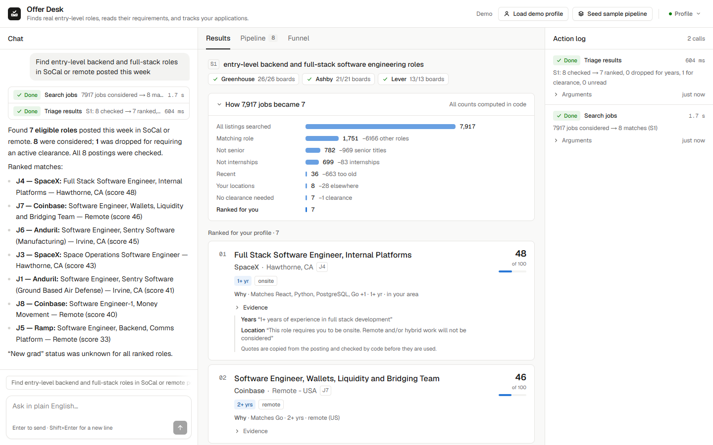
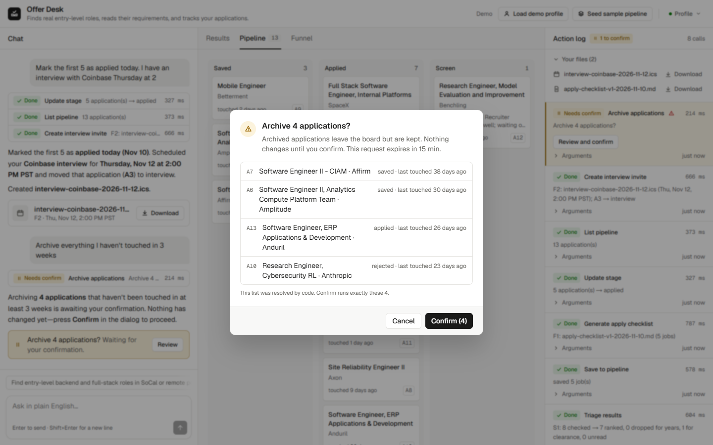
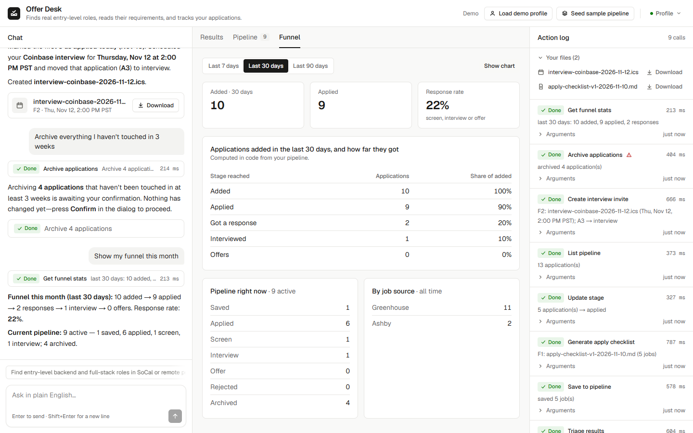
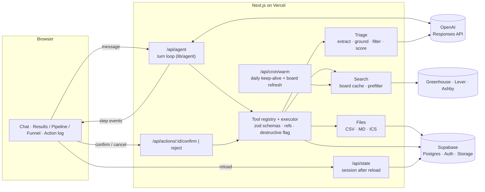

# Offer Desk

**An AI agent that does the tedious part of a new-grad job search.** You describe what you want in plain English. The agent searches real company job boards, reads each posting to find the actual requirements (years of experience, security clearance, location), drops the fake "entry-level" ones, ranks the rest against your profile, and tracks your applications. It also writes real files: an apply checklist, a CSV export and calendar invites.

**Live app:** https://offer-desk-teal.vercel.app (no sign-up; each visitor gets a private anonymous session)

CS4680 Prompt Engineering, Assignment 4 (AI Agent Project).

## The problem

"Entry level" on a job board often means three or more years of experience, an active clearance, or an office you can't move to. You only find out by opening each posting and reading the whole description, which is where a new grad's job-search time goes.

In one search, Offer Desk took **7,917 listings on 60 company boards down to 8 candidates** with code filters (role, seniority, internships, date, location). It then read all 8 postings with the LLM, dropped one that needs an active clearance, and ranked the rest. Every number on screen is counted by code, and every requirement it acts on comes with a quote from the posting, which code checks before using it.

## Features

- **Natural-language search** across 145 companies' Greenhouse, Lever and Ashby boards, with a per-board cache and stale-while-revalidate.
- **Requirement extraction** with Structured Outputs: years, clearance, location type, degree, skills and new-grad fit, each backed by a quote from the posting.
- **Honest funnel:** "How 7,917 jobs became 7", with what each step removed. Dropped jobs show the quote that dropped them, and unread jobs stay visible rather than disappearing.
- **Ranking computed in code** (skills, new-grad fit, location, recency; out of 100) with a "why it matched" line.
- **Pipeline board:** save, change stage, add notes, archive or delete, plus a funnel tab with response rate.
- **Real files:** a Markdown apply checklist, a CSV export and `.ics` interview invites (timezone-correct) in Supabase Storage.
- **Safety:** destructive actions only *propose*. A dialog lists exactly what will change, and nothing runs until you click Confirm.
- **Action log:** every tool call with its arguments, the arguments code resolved, status and duration.

| Confirming a destructive action | Pipeline funnel |
|---|---|
|  |  |

## How it works

**Design rule: the LLM routes and extracts; code computes.** The model has three jobs: choose tools and fill in their arguments, pull structured fields out of messy postings, and summarize tool results. Filtering, scoring, deduping, counting and date math are deterministic code, so the agent never makes up job data or numbers.

One turn: the model gets the message plus a compact `<state>` block (profile, pipeline counts, recent refs, pending confirmations) and calls tools. The executor validates each call against the tool's zod schema and resolves short refs like `J4` or `A2` to the user's own rows. Then it either runs the tool or, for destructive tools, stores a *proposal*. Results go back to the model, up to 8 calls per turn. The UI shows each step, and every call is logged.

### LLM vs. code

| The LLM does | Code does |
|---|---|
| Picks tools and fills arguments (function calling) | Validates every argument, resolves refs, rejects unknown tools |
| Extracts requirements from a posting (strict JSON) | Checks every quote exists in the posting and supports the answer; retries once with the exact problems |
| Writes a short summary of what happened | Search, dedupe, prefilter, the years/clearance filter, scoring, all counts, date math, file contents |

## Assignment requirements → code

| Requirement | Where |
|---|---|
| **LLM integration:** send/receive, API errors, rate limits | `lib/llm/openai.ts` (Responses API), `lib/http/retry.ts` (backoff with jitter, honors `Retry-After`), `lib/safety/limits.ts` (per-session, per-IP and global daily budgets) |
| **Parse LLM output into commands** | Function calling → `lib/agent/executor.ts`: each tool's zod schema validates the arguments before anything runs |
| **Actions across domains** | **External APIs:** job boards (`lib/sources`). **Database:** pipeline CRUD in Supabase (`lib/agent/tools/pipeline.ts`). **Files:** CSV / Markdown / ICS in Storage (`lib/files`, `lib/agent/tools/files.ts`) |
| **UI:** natural-language input, results, status, feedback | `components/`: chat with a step timeline, results/pipeline/funnel tabs, action log, toasts, file cards |
| **Validate LLM output** | zod on tool arguments and extractions, ref ownership checks, grounding checks on quotes (`lib/triage/schema.ts`) |
| **Graceful errors** | Typed tool errors go back to the model so it can fix the call once; partial source failures still return results; friendly UI messages |
| **Confirmation for destructive ops** | `archive_applications`, `delete_applications` and `delete_files` only propose. `components/confirm-dialog.tsx` shows the code-resolved list; `/api/actions/:id/confirm` runs the stored arguments |
| **Audit log** | `action_log` table: one row per tool call with status changes, shown live in the right panel |

## Prompt engineering

Full write-up with methods and numbers: **[PROMPTS.md](PROMPTS.md)**. Highlights:

- **Extraction prompt v1 → v2:** held-out accuracy went from **89.4% to 98.9%** (12 postings from companies not used for tuning, 3 runs each). The techniques: decision rules with tie-breakers, three synthetic few-shot examples, Structured Outputs, grounding quotes checked by code, and one corrective retry with the exact validation errors.
- **Agent prompt v1 → v4:** a routing eval checks what the model *did* (tools, refs, arguments, whether it asked) on tuning and held-out scenarios. v4 moved date math out of the prompt and into code.
- **Defense against prompt injection:** postings are delimited data, the extraction call has no tools, and posting text never reaches the agent model.

Prompts are versioned in [`prompts/`](prompts/), and a prompt only becomes current after it beats the previous version on the eval.

## Run it locally

Requires Node 24 (what CI uses), a Supabase project and an OpenAI API key.

1. `npm ci`
2. Copy `.env.example` to `.env.local` and fill it in:

   | Variable | What |
   |---|---|
   | `OPENAI_API_KEY` | OpenAI key |
   | `OPENAI_MODEL` / `OPENAI_EXTRACT_MODEL` | Agent and extraction models (we use `gpt-6-luna` for both) |
   | `NEXT_PUBLIC_SUPABASE_URL` / `NEXT_PUBLIC_SUPABASE_PUBLISHABLE_KEY` | Supabase project URL and publishable key |
   | `SUPABASE_SECRET_KEY` | Supabase secret key (server only) |
   | `ADZUNA_APP_ID` / `ADZUNA_APP_KEY` | Leave blank (the Adzuna source isn't built) |
   | `CRON_SECRET` | Any long random string; protects `/api/cron/warm` |

3. In Supabase, enable anonymous sign-ins and run `supabase/migrations/*.sql` in order (SQL Editor).
4. `npm run dev` and open http://localhost:3000. Click **Load demo profile**, then try a suggested prompt.

### Checks and evals

| Command | What it checks |
|---|---|
| `npm run check` | Lint, types, 400+ unit and route tests with coverage floors, production build (CI runs this) |
| `npm run check:rls` | Row Level Security against your Supabase project |
| `npm run check:live` | The deployed site: sessions, and 401s on every protected route |
| `npm run check:ui` | The demo script end to end in headless Edge (`BASE_URL=…` for the deployment) |
| `npm run eval` / `npm run eval:agent` | Extraction and routing evals (call OpenAI directly) |

See [TESTING.md](TESTING.md) for the testing standards. Every design decision, with its reason, is recorded in [DECISIONS.md](DECISIONS.md).

## Known limitations

- **Board coverage:** 145 hand-picked companies on Greenhouse, Lever and Ashby, not the whole market. Adzuna was planned as an optional source but not built (DECISIONS 017): it needs a key and its free trial could expire during grading.
- **Exact-match dedupe only:** the same job posted twice under different titles shows twice.
- **No streaming:** a turn takes about 5–15 s, with a spinner and the step list at the end.
- **Snapshot fallback:** if every live board fails, a bundled 120-posting snapshot is used and labeled as such.
- **Model judgment varies at the edges:** "clearance eligible" vs. "active clearance" sometimes differs between near-identical postings. The prompt-v4 agent once proposed *archive* for "delete" (it fails safe: the dialog shows "Archive", and nothing runs without Confirm). It also occasionally reruns a search.
- **Shared budgets:** to protect the API bill there are limits of 15 chat turns per session and 30 per network per hour, and 500 model calls per day for the whole app. Many people on one network share that network's limit.
